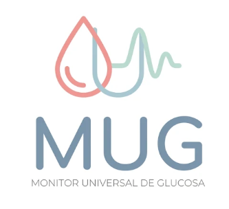

  

<h1 align="center">MUG · Monitor Universal de Glucosa</h1>

  <strong>Convierte cualquier tablet o teléfono Android antiguo (desde Android 5.0 Lollipop) en una pantalla dedicada de monitoreo continuo de glucosa.</strong>

---

## 📲 Descargar Aplicación (APK para Android)

Puedes descargar el instalador directo para Android haciendo clic aquí:

👉 **[Descargar MUG Monitor APK (`mug-monitor.apk`)](https://github.com/alvarolave-design/mug/raw/main/builds/mug-monitor.apk)**

### Cómo instalarla en tu celular o tablet antiguo:
1. Descarga el archivo **`mug-monitor.apk`** en el teléfono o tablet Android (o envíalo por WhatsApp / Bluetooth / cable USB).
2. Al abrirlo, si Android solicita permiso para instalar aplicaciones de *Orígenes desconocidos*, actívalo.
3. Abre **MUG Monitor**, toca el menú **`☰`** (arriba a la derecha) → **🔗 Conectar Cuenta** e ingresa el correo y contraseña de tu cuenta de seguidor de **LibreLinkUp** (o la URL de tu servidor **Nightscout**).

---

## ✨ Características Principales
- **Compatible con equipos antiguos:** Funciona desde **Android 5.0 Lollipop** en adelante, ideal para reutilizar tablets o teléfonos guardados como monitor de velador o escritorio.
- **100% Autónoma:** Se conecta directamente a la nube de **LibreLinkUp** o **Nightscout** sin depender de un computador encendido.
- **Lectura a distancia:** Números gigantes de alto contraste, flecha de tendencia y colores según rango glucémico.
- **Protección contra datos antiguos:** Si el sensor lleva más de **5 minutos** sin reportar lecturas, la pantalla pasa a color gris con texto negro mostrando **`-.-`** (`Sin Información de Sensor`) para evitar confusiones con valores pasados.
- **Pantalla siempre activa y Modo Noche:** Mantiene la pantalla encendida (`KEEP_SCREEN_ON`) e incluye regulador de brillo nocturno y gráfico de tendencia en el menú.

---

## 💛 Apoyar el Proyecto (Donación Voluntaria)

**MUG Monitor** es una aplicación **100% gratuita y sin publicidad**. Si te resulta útil para el monitoreo diario y deseas apoyar su mantenimiento y mejoras con un aporte voluntario, puedes hacerlo desde tu teléfono principal por cualquiera de estos medios:

- 💜 **Pagar con MACH:** [https://app.soymach.com/rF2V/fnfvmt1m](https://app.soymach.com/rF2V/fnfvmt1m)
- 🤝 **Mercado Pago:** [https://link.mercadopago.cl/codigocreativo](https://link.mercadopago.cl/codigocreativo)
- 💙 **PayPal.Me:** [https://www.paypal.com/paypalme/codigoCreativo](https://www.paypal.com/paypalme/codigoCreativo)

---

## 📧 Contacto y Soporte
- **Desarrollador:** Alvaro Olave · Código Creativo
- **WhatsApp de Soporte:** [+56 9 3223 2764](https://wa.me/56932232764?text=Hola%2C%20vi%20la%20app%20MUG%20Monitor%20y%20tengo%20una%20consulta)
- **Correo electrónico:** [codigo.creativo.ao@gmail.com](mailto:codigo.creativo.ao@gmail.com)

---

## ⚖️ Aviso Legal
**MUG (Monitor Universal de Glucosa)** es una herramienta secundaria de visualización con fines exclusivamente informativos. **No es un dispositivo médico certificado** ni reemplaza al lector o aplicación oficial del fabricante del sensor. No se deben tomar decisiones médicas ni de dosificación de insulina basándose en esta aplicación.
